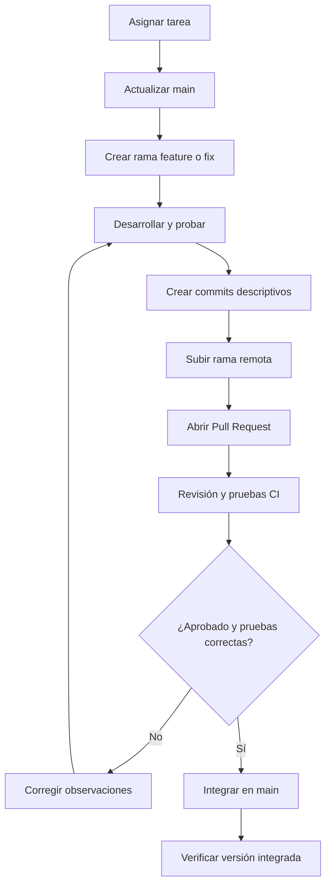

# Flujo de versionamiento

## Reglas
- No trabajar directamente sobre `main`.
- Usar una rama por tarea.
- Solicitar al menos una revisión de otro integrante.
- Corregir observaciones y ejecutar nuevamente las pruebas.
- Integrar únicamente cuando se cumplan los criterios acordados.
